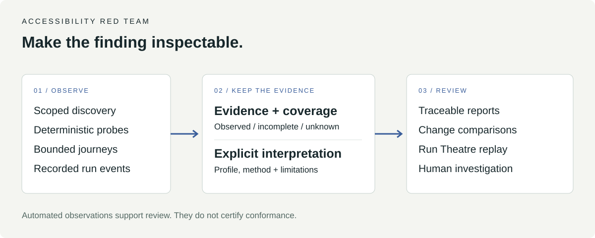

# Accessibility Red Team

### Find barriers. Preserve evidence. Track what changes.

An accessibility assessment toolkit for exploring Swiss public-sector websites. It combines scoped discovery, automated probes, bounded keyboard journeys and traceable reports so reviewers can distinguish findings from questions that still need human judgment.

**[Try the recorded run](#start-with-a-recorded-run) · [Run a probe](#run-a-probe) · [Architecture](docs/ARCHITECTURE.md) · [Evidence model](docs/REQUIREMENT_CAPABILITY_EVIDENCE.md)**



*Evidence flow, not an application screenshot. Explore the real recorded run through the replay instructions below.*

> **Research and engineering prototype.** Automated results support investigation and remediation. They do not certify WCAG conformance or establish legal applicability. The deterministic scanner works without an LLM.

## Start with a recorded run

Explore the pipeline before installing the scanner. From a fresh clone, use Python 3:

```bash
git clone https://github.com/blackmath88/accessibility-red-team.git
cd accessibility-red-team
python3 -m http.server 8080 --bind 127.0.0.1
```

Open **[Run Theatre on localhost](http://127.0.0.1:8080/theatre/theatre.html?src=runs/zh-small-pilot-2026-10-09.events.jsonl)**. Press play, pause, or scrub through the recording. The theatre displays event evidence and the stages that produced it. [Replay controls and format](theatre/README.md).

## What you can do

| Task | Result |
|---|---|
| Probe a page | Accessibility observations, a screenshot and run metadata |
| Explore representative site surfaces | A bounded discovery record for subsequent assessment |
| Run opt-in journeys | Keyboard focus, skip-link, expanded-control and dialog observations |
| Build a report | Findings linked to evidence and an explicit requirement profile |
| Compare reports | New, persisting, resolved or non-comparable findings |
| Inspect an assessment | Recorded pipeline events in Run Theatre |

The repository also contains an operator UI and a Cloudflare control plane. Their configuration and deployment are separate from the local scanner: see [control-plane setup](cloudflare/README.md) and [architecture](docs/CONTROL_CENTER_ARCHITECTURE.md).

## Run a probe

Use **Node.js 20+** and npm. Select a public target you are authorised to assess; the example below makes network requests to `example.com`.

```bash
npm ci
npm run playwright:install
npm run check
npm run scan -- https://example.com --out runs/example
```

The run writes `manifest.json`, `snapshot.json`, `probe-results.json`, `summary.json`, `coverage.json` and `page.png`. Inspect `coverage.json` for what the tooling can assess and what remains outside its scope.

For reports, jurisdiction profiles, comparisons and optional journeys, use the [scanner guide](.github/SCANNER_GUIDE.md). Start with the recorded replay if you only want to explore the interface without contacting a target.

## Evidence before conclusions

- axe violations, incomplete results, passes and inapplicable checks remain distinct.
- Journey outcomes are kept separate from standards findings.
- A profile supplies an explicit interpretation context; a canton profile does not establish municipal applicability.
- Scanner or profile changes can make two runs non-comparable.
- Safe journeys do not submit forms, authenticate, upload, pay or intentionally write server state.

AI is optional and bounded at semantic interpretation edges. It is not the authority for scope, control flow or a conformance verdict. [Design rationale](docs/SEMANTIC_COMPILER.md).

## Find your next step

| Need | Read |
|---|---|
| Scanner commands and report outputs | [Scanner guide](.github/SCANNER_GUIDE.md) |
| What a finding can legitimately claim | [Requirement capability and evidence](docs/REQUIREMENT_CAPABILITY_EVIDENCE.md) |
| Behavioural probe boundaries | [Safe journeys](docs/SAFE_JOURNEYS.md) |
| Recorded field work | [Field validation](docs/FIELD_VALIDATION.md) |
| How the project is organised | [Architecture](docs/ARCHITECTURE.md) |
| Contribution and verification | [Contributing](CONTRIBUTING.md) |

**Reuse:** a repository-wide code license has not yet been declared. The [dependency attribution](docs/OPEN_SOURCE.md) documents upstream components; it does not license this project's own code.
