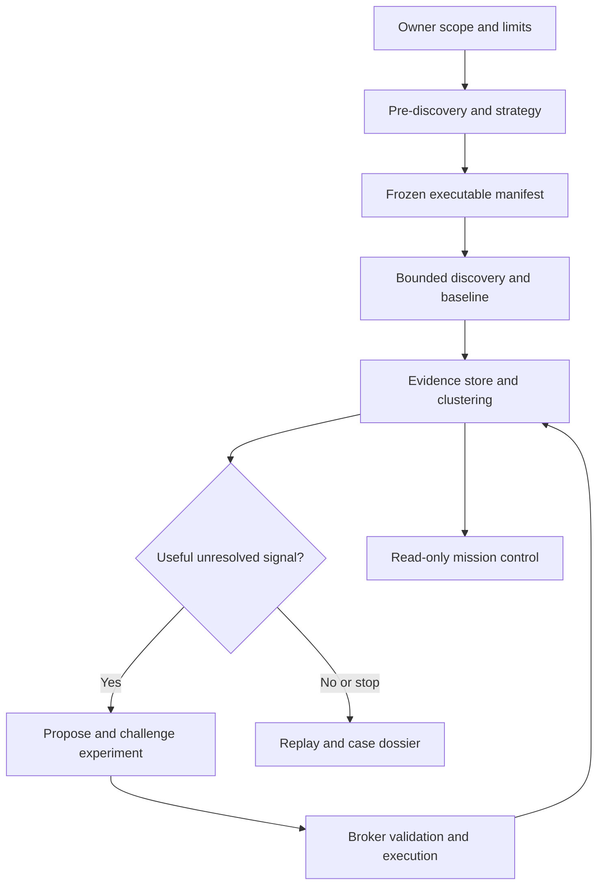

# Basel adaptive accessibility pilot — scope to evidence

Latest operating agreement: [Autonomous campaign build handoff](AUTONOMOUS_CAMPAIGN_BUILD_HANDOFF.md).
One launch, autonomous in-scope adaptation, live milestones/logs and checkpointed resource extension;
no approval at every stage. Build a working local rehearsal first.

Date: 2026-10-30
Status: proposed pilot plan; no new run, dispatch, merge, deployment or outreach authorized by this document.
Companion: [Apertus use-case and adaptation roadmap](APERTUS_ACCESSIBILITY_ROADMAP.md).
Draft allocations: [basel-pilot.proposed.json](basel-pilot.proposed.json), a planning artifact with execution disabled,
not a manifest accepted by an existing runtime.
This extends the [AIL milestone](BASEL_ADAPTIVE_INVESTIGATION_MILESTONE.md); it does not replace historical experiment records or relax ADR-0012/0013/0015.

## Outcome

The owner supplies an area and civic priorities. The system maps the public service estate, proposes a strategy,
collects a representative baseline, opens bounded investigations where the evidence warrants them, and produces
a short visual dossier with reproducible cases and a proposed partner pilot.

Success is useful evidence about residents' ability to complete public tasks, including rejected suspicions and
instrument defects. Neither more URLs nor more model calls is success. Accessibility red teaming here means
challenging access to public services; no security scanners, exploitation or intrusive probing.

The desired operator experience:
1. Enter “Basel-Stadt, canton plus its municipalities”, priorities, exclusions and resource limits.
2. Receive a sourced service/ownership map, uncertainties and a reviewable collection plan.
3. Start one explicitly approved bounded batch.
4. Watch evidence accumulate and see why a targeted investigation was selected, revised, rejected or stopped.
5. Review at most three case cards and the scope map, with a clear next action.

## Readiness at the planning checkpoint

Inspected implementation branch: PR #58 at df2abc7b1e0accb51428311a40fac51ef16fa549; main is a separate integration baseline.
Refresh live heads before implementation. Do not copy the PR stack blindly or assume it is already on main.

Present in code/evidence:
- Deterministic Scout, axe, safe journeys, grouping, comparison and evidence/publication foundations.
- Separate experimental broker/sandbox and generated-probe path.
- M1 desktop rendering investigation with fresh replay; handwritten mobile countertest labelled.
- t1 partial transfer and t2 successful, strongly hinted local attribution; model conclusions can still be wrong.
- Read-only investigation bundle and control-center view.

Not established:
- Autonomous canton-wide discovery and prioritization.
- A public general-purpose dynamic executor: same-origin iframes and other resource-policy limits remain.
- Reliable viewport compliance: t2 probe opened both viewports regardless of packet; duplicated measurements
  and mislabeled screenshot filenames must not become independent replications.
- Independent review of all changes after the recent lock review.
- Apertus provider, locally accelerated Apertus, any trained accessibility weights, expert/AT acceptance.
- Total Claude allowance/usage and coordinator cost; API spend alone is not total cost.

Go now for preparation and local evaluation. Start the live batch only after the explicit manifest and field-readiness
checks below are satisfied. No further general framework is needed first.

## Geography and ownership

Initial geographic interpretation: Basel-Stadt canton, city/municipality of Basel, Riehen and Bettingen.
Official source: https://www.bs.ch/schwerpunkte/portrait/im-herzen-europas/basel-ein-kanton-drei-gemeinden
Basel-Landschaft and cross-border services are excluded unless added through a distinct scope amendment.

Do not force a one-government/one-domain hierarchy. The same site may serve cantonal and municipal tasks.
Maintain linked records for:
organization → civic task → entry page → application/provider boundary → page/state evidence.
Record legal jurisdiction, public ownership, named service office, technical operator and release authority separately.
Unknowns stay unknown. “For this topic responsible” is not proof of technical operation or maintenance contract.

Start from the existing 25-service inventory, official organization/service directories, sitemaps, accessibility
statements and the two preserved research reports. Reports are leads; material facts require primary-source checks.
Riehen/Bettingen entry origins must be resolved from official sources, not guessed from names.
Hospitals, transport, utilities, universities, Bürgergemeinden and shared platforms are estate-research leads;
public affiliation does not automatically place their sites in this pilot's test scope.

## Operating architecture

Software owns scope admission, queue ownership, request accounting, resource limits, execution permission and stop rules.
Models propose strategy, sample priorities, hypotheses, experiments and interpretations inside those bounds.
A plan revision records its reason, parent revision, evidence IDs and request/resource delta.
An in-scope reprioritization can proceed automatically; a new origin, action class, spend limit or authority needs
an explicit scope amendment. Model text and page content cannot grant it.

Use existing TypeScript/Zod, ModelProvider, Scout, evidence contracts and broker.
Claude Code is the senior coordinator using the verified subscription session. Orca is useful for independent
research/build/review workers, not a replacement for the deterministic scan scheduler.
Do not add PydanticAI or a Python runtime for this pilot; revisit only if a measured missing capability warrants it.

Weavr remains canonical for an applicable governed Mission; Orca provides worker execution.
During this planning session Weavr MCP returned UNAUTHORIZED / requires reauthentication. No governed state,
runner eligibility or dispatch was established. Do not use GitHub inbox commands to bypass authentication.
An explicitly authorized local Claude preparation session can inspect/build independently without inventing Mission state.

## Stages and outputs

### P0 — pre-discovery, strategy and scope compilation

Research the official public estate before choosing probes:
- What resident tasks matter; where their public guidance, application and login/payment boundaries differ.
- Which bodies and platforms are shared; content versus application templates; languages and PDF/embedded content.
- Current accessibility statements and applicability sources; municipal applicability is not inherited from canton.
- Known false positives and candidate status: do not reuse the focus heuristic as a confirmed Basel issue.
- What differs from a normal small-municipality assessment and why that changes the sample.

Outputs: scope-map.json, strategy.md, source/claim ledger and proposed exact-origin/path manifest.
Confidence applies to each relationship; do not turn directory membership into a state-ownership claim.

### P1 — broader, bounded discovery

“Broader” means more representative task and platform coverage, not exhaustive crawling.
Deterministic tools fetch links/sitemaps and record provenance; AI reasons over the resulting map.
Preserve URL normalization, template fingerprints, task labels and excluded boundaries.
Discovery finds new hosts but does not enqueue them for assessment.
Show assessed / discovered-only / excluded / blocked separately, including reasons.

Choose up to 15 representative public surfaces across Basel, Riehen and Bettingen, subject to official seed
verification and scope confirmation. Priorities: relocation/public registration guidance, waste information,
parking or permit guidance, benefits/childcare information, and one public document/form entry.
A task ending at login is a valid mapped boundary; it is not an end-to-end success.

### P2 — deterministic baseline, with streaming triage

Run the existing supported checks, retain incomplete results and suspected tool defects.
Publish observations to a local append-only stream and group repeated template occurrences.
AI can prioritize an investigation while other approved measurements continue.
It cannot change the baseline engine in place or retroactively rescore it.

A signal should open an investigation only when:
- It affects a meaningful public task.
- Existing evidence leaves a testable question.
- A small countertest can resolve it within remaining resources.
- It is not merely another occurrence of a known shared template issue.
Permit one uncertain/high-impact outlier slot to avoid only chasing the most frequent pattern.

### P3 — bounded adaptive investigations

At most three investigations, one active generated-probe execution initially.
Each has a baseline observation, competing explanations, proposed code/hash, required capabilities, controls,
expected evidence and stop conditions. Permit one revision before explicit escalation/stopping.
Fresh observations can create a child investigation inside the fixed manifest; it shares the SAME global budget.
Do not recursively spawn scans or expand the frontier through a model's URL suggestions.

Run controls locally before live targeted measurements. New read-only broker fields are reviewed implementation
changes, not generated permission escalation. Enforce packet viewport and record actual dimensions, DPR,
browser version, scroll and screenshot hash independently of model labels.
Record whether a model actually inspected screenshots; file availability does not imply visual reasoning.

Live dynamic work remains limited to an explicitly accepted exact URL/action profile.
The current Zonensuche permission is not a general permit for generated probes on every discovered service.
If its stricter boundary is not ready, collect the deterministic baseline and run dynamic analysis on frozen evidence/local fixtures.

### P4 — challenge, reproduce, cluster and propose repair

Validate claims against geometry/pixels/focus/ARIA/DOM as appropriate. Judge is advisory; measurements and
counterexamples determine support. Distinguish observation, causal explanation, user-impact hypothesis and rule applicability.
Countertest/fresh replay failure remains visible, not overwritten.

Group only supported relationships, retaining original occurrences and reversible cluster membership.
A likely shared component is a hypothesis until compared across structures.
Propose minimal repairs on local copies; never mutate a live government page.
Rerun the same measurement on defective/control/repaired local states, retaining code/config comparability.
Expert and actual AT validation is a separate future partner activity; do not claim keyboard scripts simulate an SR user.

### P5 — concise partner dossier

One overview plus at most three case cards:
- public-task and estate scope map with tested/untested boundaries;
- actual user-facing observation and screenshot comparison;
- what baseline code found, what AI added, and what was rejected;
- measurement, replay, version and provenance links;
- who may own service/content/platform fixes, with sourced versus unknown distinctions;
- a proposed local repair/retest where possible, and the next validation question.

Do not publish raw hypotheses, unapproved findings or private archives. Report supported observation, candidate,
AT-needed and rejected tool alarm as distinct states.
No aggregate “Basel accessibility score”, legal compliance verdict or full-site coverage claim.
Draft for owner review; no contacting Basel or Apertus partners under this plan.

## Proposed first execution envelope — not active permission

Prepare a draft manifest; keep status proposed and execution disabled until reviewed for a specific batch.
One 180-minute supervised pilot, reserve last 30 minutes for replay/report/settlement.
- Max 180 top-level document fetch/navigation attempts TOTAL, across phases, workers, failures and fresh replays.
  Reservations: 6 policy/sitemap entry requests; 90 discovery documents; 60 baseline/journey/replay loads;
  24 targeted measurement loads. These sum to 180. Unused reservations may be reassigned by a logged plan revision.
  Redirect hops that reach the network count individually. Asset requests are separate and capped below.
- Up to 3 admitted first-party origins initially; path restrictions preserve Riehen/Bettingen separation on shared hosts.
  ePortal or any fourth origin must replace an allocation or be separately admitted within the reviewed manifest.
- At least 10 seconds between document requests per host, or stricter site guidance; host concurrency 1,
  global page concurrency at most 2 across distinct hosts. Same-host branches share the same rate limiter.
- Per-document caps proposed: 45 seconds, 250 subresource requests, 20 MiB transferred.
  These require enforcement verification; do not label a promise as an implemented limit.
- Robots disallow/429/503/Retry-After or denial stops/pauses work; no retry amplification.
- No login, form typing/submission, upload, payment, CAPTCHA bypass, downloads, live DOM writes or security probes.
  Only previously reviewed reversible journey actions, each explicitly selected in the manifest, are eligible.
- Fix/disable same-origin iframe document fan-out and record/block popup/navigation/resource paths before broader
  live dynamic execution. Use local hostile fixtures, not public sites, to verify limits.
- Max two agent workers; one browser scheduler, one global ledger and atomic reservations.
  Parallel research/analysis is preferable to increasing traffic on bs.ch.
- Claude existing eligible subscription only. Prior Mistral aggregate was USD 0.1042252; verify actual ledgers and
  retain the ORIGINAL USD 5 cap. No new Apertus spend, hosting, training or access-term acceptance is authorized.
  Existing valid credits/route can be proposed; model evaluation starts only after endpoint/data/budget approval.

## Resource routing and measurement

| Work | First route | Evidence needed |
| --- | --- | --- |
| Estate/task research and strategy | Claude coordinator + deterministic retrieval | source-linked map and reasoned sample |
| Collection, normal probes, queue/budgets | Deterministic runner on verified eligible host | request ledger, code/browser versions |
| Dynamic experiment design and hard inference | Claude, based on demonstrated t2 ability | probe execution, controls, unsupported claims |
| Clustering/extraction candidates | Apertus shadow evaluation; Mistral optional comparator | held-out errors, abstentions and review time |
| Fresh criticism/review | Independent qualified context | exact reviewed input/code and findings |
| Local execution | Nebu for browser/sandbox; NUC if eligible and selected | host/runtime preflight, actual model backend |
| Final acceptance | Owner plus future expert/AT partner | explicit human decisions, not model consensus |

Nebu is an execution host, not a model. Local inference and Swiss-hosted Apertus are separate routes.
Do not assume Arc B60 support from theoretical VRAM. Confirm backend, quantization, context, latency and exact model.
Prefer Claude CLI subscription for senior coordination; do not convert it into an undocumented general API relay.
Record actual model IDs, provider, host, harness, auth class and context/config hashes independently.

Track accepted useful cases, false claims, incomplete coverage, new evidence beyond baseline, repeated-template
deduplication, probe/code failures, human/coordinator interventions, wall time and provider usage.
Subscription and local usage are not “zero cost”; unknown quota/energy/utilization stays unknown.

## Immediate implementation packet

A 90-minute preparation slice, zero public-site requests and no new paid calls:
1. Preserve latest historical evidence; fix viewport/artifact attribution and complete t2 local repair/retest.
2. Add the smallest scope/strategy/batch JSON validation and dry-run queue around existing tools.
3. Populate the draft scope map from existing inventory and cached sources, with Riehen/Bettingen verification tasks.
4. Render planned allocations, ready/blocked origins and case evidence in the existing workspace.
5. Prepare the Apertus evidence-task evaluation packet and endpoint preflight, but do not call an unapproved provider.

Acceptance: one reviewable pilot manifest and dry run with global quotas enforced locally, a complete synthetic
repair/retest card, and a clear list of missing live prerequisites. No additional dashboard/runtime framework.

## Sources and plan lineage

- Existing M1/t1/t2 evidence and PR #58 at the inspected commit above.
- Basel scope/map and research input carried by PR #54/#55.
- Basel official geographic page linked above (read 2026-10-30).
- Apertus primary sources and community-list provenance: companion roadmap.
